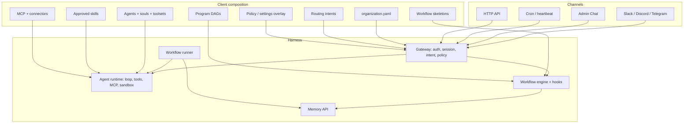

# Harness Blueprint

A scalable, modular foundation for standing up TS Harness on client projects. The runtime is the product. Each client engagement is a composition of agents, skills, workflows, programs, routing, and policy — not a fork.

This document is the delivery contract: what you inherit, what you compose, what you never change, and the standard path from a client brief to a live governed program.

Related: [vision](./vision.md) · [agent runtime](./agent-runtime.md) · [workflow engine](./workflow-engine.md) · [workflow hooks](./workflow-hooks.md) · [routing overlay](./routing-overlay.md)

## One-line summary

**Ship the same harness every time. Customize the client through versioned configuration, approved skills, and builder-activated definitions — never by branching the orchestrator.**

## Who this is for

| Audience | Use this document to |
|----------|----------------------|
| Delivery leads | Scope a client engagement against the platform, not a custom runtime |
| Platform engineers | Decide whether a request belongs in the harness or in client composition |
| Client operators | Know which Admin Console surfaces they own after go-live |
| Solution architects | Map a new domain onto the proven intake → produce → gate → optional pipeline pattern |

## What the harness is

TS Harness is a **governed multi-agent operating system**. People express intent in a channel or the console. The gateway classifies that intent, applies policy, and routes it to one of two outcomes:

- **Ephemeral delegation** — a specialist handles a one-off task in chat.
- **Durable program** — a versioned DAG of workflows with checkpoints, human gates, revise loops, and an audit trail.

The orchestrator is a **router**. Specialists hold domain knowledge. Skills encode procedures. Workflows encode process. Programs compose workflows into a delivery topology. Policy enforces boundaries. Memory persists state across sessions, agents, and time.

Product and engineering (`software_delivery`) is the first reference vertical. Sales RFP and marketing content campaign prove the same path works outside engineering. A client project is the next vertical, not a new product.

## What you never fork

These layers are the harness. Client work plugs into them. If a client request requires editing the orchestrator loop, the workflow runner, or a hook for one domain, that is a design smell — prefer config, a skill, a hook parameter, or a policy rule.

| Layer | Lives in | Responsibility |
|-------|----------|----------------|
| Agent runtime | `runtime/ts_harness/` | Gateway, auth, sessions, tool loop, MCP, sandbox, policy pipeline |
| Workflow engine | `runtime/ts_harness/workflows/` | Skeleton interpretation, hooks, expressions, fragments, child forks |
| Memory API | `scripts/memory-gateway.py` + `database/migrations/` | Tenant-scoped state, claims, artifacts, audit |
| Workflow runner | `scripts/workflow-runner.py` | Claim, dispatch, retry, recover, complete / block / fail |
| Admin console | `admin-ui/` | Inbox, Chat, Programs, builders, System Settings |
| Install / infra | `scripts/install.sh`, `infra/aws`, `infra/gcp` | One-cloud install, Compose, secrets, volumes |

Configuration sits **above** this stack and defines *what* runs. The runtime defines *how* it runs safely.

```text
┌──────────────────────────────────────────────────────────────┐
│  Client composition  (overlays, builders, managed volumes)   │
│  agents · skills · toolsets · MCP · workflows · programs     │
│  routing · policy · org context · connectors                 │
└──────────────────────────────┬───────────────────────────────┘
                               │  draft → validate → activate
┌──────────────────────────────▼───────────────────────────────┐
│  Harness  (do not fork per client)                           │
│  gateway · agent loop · tools · policy · hooks · runner      │
│  memory-api · sandbox · channels · admin console · install   │
└──────────────────────────────────────────────────────────────┘
```

## Composition model

Every client capability is assembled from the same modules. Each module has one job, a declared interface, and an independent activation path. Modules communicate through catalogs and version pins, not through shared Python branches.



### Module catalog

| Module | What it does | How you add it | Depends on |
|--------|--------------|----------------|------------|
| **Organization** | Company name, channels, Jira keys, contacts, glossary | Copy `config/organization.example.yaml` to `config/organization.yaml` (gitignored) | Nothing |
| **Agent** | Specialist identity, model, soul, toolsets, skills, allow/deny | System → Agents, then Activate | Toolsets, optional skills |
| **Toolset** | Named bundle of tools shared by every agent that opts in | System → Settings → Toolsets | Registered tools / MCP / connectors |
| **Skill** | Procedure the agent follows on a stage | Learn / paste / upload → Inbox approve | Assigned to an agent; optional folder refs |
| **MCP / connector** | External systems (CMS, Docs, Jira, GitHub) | System → MCP or Settings → Connector | Secrets by name, never pasted credentials |
| **Workflow** | Versioned stage graph: tasks, gates, hooks, `input_map` | Workflow Builder → Validate → Activate | Agents, approved skills, hook catalog |
| **Fragment** | Reusable stage sequence included by `kind: fragment` | Fragment builder → Activate | Same as workflows |
| **Program** | DAG of workflow phases, artifacts, edges, adapters | Program Builder → Validate → Activate | Active workflow types, completion adapters |
| **Routing intent** | Channel phrases → program / workflow / delegate + policy | System → Settings → Routing → Activate | Active program or workflow type |
| **Runtime settings** | Tenant Jira defaults, identity maps, policy, sandbox, channels | System → Settings → Activate | YAML baseline |
| **Cron** | Scheduled skill or heartbeat | System → Cron | Approved skill, agent |

If a change requires a new Python hook or completion adapter, that is **platform work**, scheduled and reviewed like any harness change. It is not a client customization.

## Standard practices

These are the rules that keep the harness scalable across clients. Treat a violation as a defect, not a shortcut.

### 1. Work types are data

A new domain ships as **config + skills + tests**, not a runtime branch.

Required pieces, in order:

1. Approved skill(s) that encode the procedure
2. Agent assignment (reuse an existing specialist or add an overlay agent)
3. Workflow skeleton with stages, gates, `skill_hints`, and per-stage `tool_allow`
4. Program definition that composes the workflow into a DAG (one node is fine)
5. Routing intent with **distinct** signals
6. Smoke test through the bound channel

Do not add orchestrator conditionals, session keys named after one domain, or hardcoded `PHASE_ORDER` constants. Session metadata stays generic: `workflow_phase`, `approved_artifact`, `source_workflow_id`, `pending_bridge`.

### 2. Overlay, do not edit the rendered YAML

`config/ts-harness-runtime.yaml.tmpl` is the **bootstrap baseline**. Live client changes go through managed overlays. Activate never writes the install YAML.

| Store | Path (default) | Owns |
|-------|----------------|------|
| Runtime settings | `/workflow-definitions/runtime-settings` | Policy, sandbox, channels, toolsets, connector, Jira/identity defaults |
| Routing | `/workflow-definitions/routing` | Channel start intents |
| Agents | agents overlay store | Overlay specialists and YAML overrides |
| Workflows | `/workflow-definitions` | Managed skeletons (draft / active / history) |
| Programs | `/workflow-definitions/programs` | Managed program DAGs |
| Skills | `/skills-managed` | Admin-created and `/learn` skills |

Merge order for live runtime config:

1. YAML baseline
2. Runtime-settings overlay (present key replaces; omitted key inherits)
3. Routing overlay (wins on intent `id`; new ids append)

YAML bootstrap agents stay inherited. Overlay can override soul, tools, and skills. **Reset** drops the override. **Remove** is only for overlay-only specialists.

### 3. Draft → validate → activate is the only cutover

Every managed definition uses the same lifecycle:

1. **Save draft** — not live
2. **Validate** — schema + semantic rules (graph connectivity, known agents/skills/hooks, no cycles)
3. **Activate** — write immutable history, bump manifest generation, reload in process

Treat `reload_ok: false` as a **failed activate for ops**. The draft may be on disk; live routing or definitions did not apply. Fix the warning before any Slack or Chat proof.

Settings Activate persists routing and runtime-settings together after an in-process apply. Do not call the two single-store activate endpoints in sequence.

Builder Activate and Settings Activate are separate cutovers. A program does not start from Slack until its routing intent is activated on the Settings page.

### 4. Instances pin versions

When a program starts, memory-api persists `program_type`, `program_definition_version`, `program_definition_revision`, `program_definition_snapshot`, and `resolved_workflow_versions`. Child workflows pin the child definition that was current when the parent started.

Activating `1.1.0` affects **new** instances only. In-flight work stays on its frozen snapshot. Rollback is re-activating a history JSON as a new draft with a new `definition_version`. Do not edit an active file in place.

A `definition_version` can be activated only once per type. Edits require a new version.

### 5. Orchestrator routes; specialists execute

- The orchestrator speaks to the user, classifies intent, proposes start / bridge / advance, and synthesizes results. It does not do domain work.
- Specialists never talk to the user or each other. They return structured output. The engine presents specialist output to the bound channel unless the stage sets `present_output: false`.
- `delegatable` on a new agent appends it to the orchestrator `subagent_allow`.
- Informal work uses `propose_delegate_task`. Governed work uses `propose_start_program` / `propose_start_workflow`. Policy must deny the unsafe shortcut when a governed path is required.

### 6. Human gates stay in front of side effects

The generic pattern, proven on PRD, RFP, and content campaign:

```text
intake → produce artifact → approve/reject gate → (optional) downstream pipeline
```

Standard practices at the gate:

- Put an approval gate before anything that sends, publishes, files tickets, merges, deploys, or spends money.
- Use `revise_on_reject` for the revise loop. Do not hardcode domain reject logic in Python.
- Prefer `present_prompt: approval` so yes/no attaches to the specialist output in the thread.
- `publish_plan` (or equivalent) between "accept the draft" and "do the irreversible thing" is the content-campaign pattern. Reuse it for any external action.
- Stage `tool_allow` (**Restrict tools**) narrows a stage. It cannot grant a tool the agent does not already have. High-risk MCP tools stay off every stage except the one that should run them.
- Inbox tool approval (`approval_required_tools`) is a second pause *inside* a task. Use it for high-risk MCP calls; do not substitute it for a workflow gate.

### 7. Least privilege is layered

Privilege is not a single allow list. Compose from the inside out:

| Layer | Mechanism | Effect |
|-------|-----------|--------|
| Global deny | Runtime `GLOBAL_DENY_TOOLS` | Cannot be allowed on any agent |
| Policy | Settings → Policy (`approval_required_tools`, ingress deny, budgets) | Tenant-wide pauses and denials |
| Toolset | Settings → Toolsets | Shared membership; edit applies to every agent on that toolset |
| Agent allow / deny | System → Agents | Deny is how one agent loses a toolset tool. Empty allow = no allow list |
| Stage restrict | Workflow `tool_allow` | Narrows that stage only |
| Intent policy | Routing `policy.mode` + `deny_tools` | `require_workflow` blocks `delegate_task` for governed phrases |
| Sandbox | Settings → Sandbox | Docker isolate, CPU/memory/timeout, egress deny |

`read_skill_reference` stays on `core-read` so a restricted stage can still load its procedure. Do not deny it unless the agent must not read skills.

### 8. Skills are procedures, not platform code

- A skill is approved before a workflow can attach it. Drafts are never injectable.
- Builtin skills ship read-only from the repo (`SKILLS_DIR`). Client / operator skills live on `SKILLS_MANAGED_DIR`.
- One skill, one job. Name stages in the skill (`keywords`, `draft_asset`, `publish`) so the same file can drive several stages without becoming a second orchestrator.
- Folder skills (`SKILL.md` + `stages/`, `schemas/`) are the unit for procedures with templates. Agents load extras with `read_skill_reference`.
- `/learn` creates drafts. Revising a live skill uses `revise <id>`, not a second `/learn`. Builtin skills are revised in the repo when the two directories differ.
- `coding-backend/` is not writable from authoring. Do not teach agents to write into it.

### 9. Routing signals must be unique

Overlay intents replace YAML intents with the same `id` and append new ids. Phrase collisions (same signal text on two intents) are a validation warning and a live defect.

Clone proofs and client programs **must not** reuse built-in phrases such as `"create a prd"`. Use distinct signals (`"start acme delivery"`, `"draft acme brief"`).

Always send explicit `program_type` and `entry_phase`. Callers that omit `program_type` still default to built-in `software_delivery`.

### 10. Fail closed

- Malformed overlay or failed apply: keep the last good merged list; do not swap actives; return `reload_ok: false`.
- Missing or mismatched program history: registry fails closed.
- Approval-gated tasks cannot be claimed or marked succeeded until approval is recorded.
- Rejected tasks cannot be claimed.
- Gate agents (`review-agent`, `qa-agent`) cannot use forbidden cheap models.
- Secrets stay names (`credentials_secret`, `client_id_secret`). Pasting a key, PEM, or JSON credential fails validation.
- Single `agent-runtime` replica for cron file consistency and the managed-skills volume.

### 11. Audit is the default

Every task create, claim, completion, failure, block, cancellation, approval, and rejection writes `session_audit_log`. Tool calls and policy decisions are traceable. Program evidence is a signed JSON export for `admin` / `owner`.

If you cannot answer "who started this, which intent fired, which definition version ran, who approved, and what tool ran," the composition is incomplete.

### 12. Test the skeleton, then the channel

A client vertical is not done when the builder validates. It is done when:

1. Workflow and program activate with `reload_ok: true` on gateway **and** runner (runner does not load routing).
2. Routing (and tenant defaults) activate from Settings with `reload_ok: true` on the gateway.
3. A bound-channel run completes intake → produce → gate → (optional) downstream.
4. In-flight instance still shows the pinned definition after you activate a newer version.
5. Release gates and the relevant smoke runbook pass.

See [release gates](../../config/release-gates.yaml), [workflow-runner smoke](../runbooks/workflow-runner-smoke-test.md), and the vertical runbooks linked below.

## Client engagement playbook

Use this sequence for every new client or new domain on an existing client. Admin Console is the authoring surface. **Build with agent** on the program library can draft workflow, program, and routing for steps 4–6; a human still activates.

### 0. Install the harness

One cloud at install time. Shared bootstrap and Compose on the VM; provider Terraform under `infra/aws` or `infra/gcp`.

```bash
./scripts/install.sh validate --cloud aws --config /path/to/install.yaml
./scripts/install.sh plan     --cloud aws --config /path/to/install.yaml
./scripts/install.sh apply    --cloud aws --config /path/to/install.yaml
```

Do not mix AWS and GCP roots on one install. See [install](../runbooks/install.md), [AWS](../runbooks/aws-install.md), [GCP](../runbooks/gcp-install.md).

Post-install: OIDC for the console in production, strong `GATEWAY_TOKEN` for services, `TS_HARNESS_ALLOW_STATIC_TOKEN=false`.

### 1. Tenant context

Copy `config/organization.example.yaml` to `config/organization.yaml` and fill in company name, channels, Jira projects, contacts, and glossary. The real file is gitignored and stays local to the install; bootstrap reads it from the assets checkout, or from the path in `ORGANIZATION_CONFIG`. Keep credentials in Secrets Manager, not this file.

In **System → Settings**:

- **Identity** — Slack user → email, email → Jira account
- **Jira defaults** — allowed projects, issue types, ticket picker (programs inherit unless they set `config.mode: custom`)
- **Connector** — Google account keys such as `marketing` / `sales` with `impersonate_email`
- **Policy** — `approval_required_tools`, budgets, ingress deny
- **Channels** — approved posting targets

Validate, then Activate.

### 2. Agents and tools

Reuse a built-in specialist when the soul and trust level fit (`pm-agent`, `sales-agent`, `marketing-agent`, `dev-agent`, …). Add an overlay agent only when the client needs a distinct identity or tool envelope.

For each agent:

- Soul is one short paragraph. Non-empty overlay soul replaces the catalog soul.
- Bind the Google account if the workflow writes Docs.
- Keep `core-read` so folder skills can load references.
- Leave toolset tools checked; uncheck to deny for this agent only.
- Do not clear a populated allow list on first save — an empty allow list means there is no allow list.
- Attach only **approved** skills.

`builder-agent` drafts definitions and never activates them. Do not grant it activate.

### 3. Skills

Author the procedure before the workflow. The builder can attach only an approved skill.

Three intake paths, all drafts until Inbox approval:

| Path | When to use |
|------|-------------|
| `/learn` or **Learn a skill** | Agent writes the first draft from a description |
| **Paste skill** | You already have `SKILL.md` |
| **Upload folder** | Procedure plus `stages/` or `schemas/` |

Approve in **Inbox → Skills**. Then attach the skill on the agent and Activate the agent again.

### 4. Workflow

**Workflows → New workflow** (or clone a built-in / proven vertical).

- Unique `workflow_type` and `definition_version` (`1.0.0` for the first activate).
- Stages: task or gate. Gates use the orchestrator and `approval_required`.
- Each producing stage: specialist `agent_id`, `skill_hints`, `present_output` on, **Restrict tools** to what that stage needs.
- Side-effect stage (publish, file Jira, merge) comes after its own approval gate and has only the tools for that effect.
- Reuse hooks from the catalog (`revise_on_reject`, `wait_external`, `fork_children`, `hydrate_input`). Do not invent Python.
- Reuse fragments (`verified_merge`) instead of copying merge/QA/review stages.

Save draft → Validate → Activate. Confirm `reload_ok: true` on gateway and runner.

### 5. Program

**Workflows → Programs → New program** (or clone `software_delivery` / `rfp_response` / `content_campaign`).

- Unique `program_type`.
- Nodes reference **active** workflow types only.
- Completion adapter from the server catalog (`extract_declared_outputs` for new verticals unless you are cloning software delivery and must keep its `extract_*` adapters).
- Declare `produces_artifacts` / `required_artifacts` so edges and variants stay data.
- Input bindings seed from `program_summary`, `transcript_context`, artifacts, or static values.
- Edges are `manual` or `automatic`, with optional confirm and signals. No free-form code on edges.
- One-phase programs (content campaign) are valid: one startable terminal node, empty edges.

Save draft → Validate → Activate.

### 6. Routing

**System → Settings → Routing**. Add an intent:

- Unique `id`
- Distinct `signals` (no collision with YAML `governed_prd` or other live intents)
- `program_type` + `entry_phase` (preferred) or `workflow_type` or `delegate_agent`
- For governed work: `policy.mode: require_workflow` and deny `propose_delegate_task` / `delegate_task`

Activate on the Settings page. Confirm `reload_ok: true` on the gateway.

### 7. Prove it in the channel

Run the happy path from Slack or Chat with a real brief. Approve or reject at each gate. Confirm:

- The correct program type and pinned version appear on **Programs**
- Specialist output posts in the bound thread
- Reject revises and re-gates
- The side-effect stage does not run before its gate
- A second activate of the definition does not move the in-flight instance

### 8. Operate

- Inbox owns skill drafts, tool approvals, and workflow gates.
- Programs is the instance view (roots, children, waiting_on, recommended action).
- Back up `/workflow-definitions` (workflows, programs, routing, runtime-settings) **and** `/skills-managed` before upgrades. See [program-builder backup](../runbooks/program-builder.md#backup-and-restore).
- Rotate secrets with [secret-rotation](../runbooks/secret-rotation.md). Do not put secrets in overlays.

## Proven verticals (pattern library)

Clone these; do not treat them as the product ceiling.

| Vertical | Program | Pattern | Runbook |
|----------|---------|---------|---------|
| Software delivery | `software_delivery` | PRD → (Jira \| work orders) → implement → release; child programs for bugs and content; opt-in handoff | [PRD-first delivery](./prd-first-delivery-flow.md), [governed delivery](../runbooks/governed-delivery-flow.md) |
| Sales RFP | `rfp_response` | Intake → wait → draft → approve; `extract_declared_outputs`; sales-agent skills | [program-builder palette RFP](../runbooks/program-builder.md#palette-authored-rfp-vertical) |
| Content campaign | `content_campaign` | Keywords → asset → publish plan → MCP publish; three human gates; no email | [content-campaign](../runbooks/content-campaign.md) |
| Content → Jira WOs | `content_to_jira_work_orders` | Child program of a change; shared Jira pointer + Drive | [content-to-jira](../runbooks/content-to-jira-work-orders.md) |
| Bug → Jira WOs | `bug_to_jira_work_orders` | Investigate → plan → file; child of the change | [bug-to-jira](../runbooks/bug-to-jira-work-orders.md) |
| Jira → PR | `jira_to_pr` | Child implement path from an existing ticket | [jira-to-pr](../runbooks/jira-to-pr.md) |

The reusable shape across all of them:

1. **Intake** captures a brief or artifact pointer.
2. **Produce** is a specialist stage with a skill and a tight tool allow list.
3. **Gate** is a human approve/reject with an optional revise loop.
4. **Opt-in** (when there is a downstream pipeline) is a confirm, not an automatic surprise.
5. **Closed pipeline** after opt-in is a program edge, not an orchestrator `if`.

## Built-in versus managed

| Kind | Source | Writable by console | Role |
|------|--------|---------------------|------|
| Built-in workflows / programs / fragments | `config/workflows`, `config/programs`, `config/fragments` | No | Templates. Clone to customize. |
| YAML agents | `ts-harness-runtime.yaml.tmpl` + `config/agents/catalog.yaml` | Override, not delete | Inherited roster |
| Managed definitions | `/workflow-definitions/**` | Draft / validate / activate | Client and operator topology |
| Overlay agents | Agents overlay store | Create / reset / remove overlay-only | Client specialists |
| Builtin skills | `SKILLS_DIR` (`/skills`) | Repo PR | Platform procedures |
| Managed skills | `SKILLS_MANAGED_DIR` (`/skills-managed`) | Inbox approve | Client procedures |

Resolution: managed active first, then built-in. Same `id@version` in both skill roots: builtin wins.

## Platform extension vs client composition

Use this split when a client asks for something the builders cannot express.

| Request | Client composition | Platform change |
|---------|--------------------|-----------------|
| New domain / work type | Skill + agent + workflow + program + routing | — |
| New specialist | Overlay agent | — only if a new tool or hook is required |
| New external system with an MCP server | MCP catalog + toolset + stage restrict | — |
| New Google account | Connector accounts map | — |
| New completion adapter | — | Register adapter in runtime, then expose in catalog |
| New hook or expression token | — | Engine change + tests + hook catalog doc |
| New channel | — | Channel adapter in gateway |
| New coding backend | Implementation config | Backend adapter under `implementation/backends/` |
| Slack-native approval UI / stuck dashboard | — | Listed as future in the engine docs |

Client composition should never copy `runtime/ts_harness/` into a delivery repo.

## Design smells

Stop and re-route to config or a platform RFC if you see:

- An `if workflow_type == "acme_..."` in the gateway or orchestrator
- Session keys or policy branches named for one client
- A skill that activates definitions or approves its own drafts
- A workflow stage that can publish *and* draft
- Routing signals copied from `software_delivery` for a clone
- Editing `/workflow-definitions/active` or `ts-harness-runtime.yaml` by hand on a live host
- Granting `builder-agent` activate
- Mixing AWS and GCP Terraform on one install
- Scaling `agent-runtime` to multiple replicas while cron or managed skills are file-backed
- Teaching the model the DAG in `AGENTS.md` — durable graphs live in workflow JSON

## Operability checklist for a client go-live

- [ ] Exactly one cloud provider recorded at install
- [ ] OIDC on the console; static token disabled for browsers
- [ ] `GATEWAY_TOKEN`, `MEMORY_API_TOKEN`, `SANDBOX_WORKER_TOKEN` set and rotated
- [ ] Definition volume and skills-managed volume on the backup plan
- [ ] Tenant Settings activated (`reload_ok: true`)
- [ ] Each live program: workflow + program + routing activated with distinct signals
- [ ] Channel smoke through every startable entry phase
- [ ] Release gates green on the deployed image
- [ ] Runbooks linked from `organization.yaml` for the client's operators
- [ ] On-call knows: Inbox for gates, Programs for stuck instances, `reload_ok: false` means failed activate

## Related documentation

**Architecture**

- [Vision](./vision.md)
- [Agent runtime](./agent-runtime.md)
- [Workflow engine](./workflow-engine.md)
- [Workflow hooks](./workflow-hooks.md)
- [Routing overlay](./routing-overlay.md)
- [PRD-first delivery flow](./prd-first-delivery-flow.md)
- [Compatibility / API matrix](../compatibility.md)

**Authoring**

- [Create an agent](../runbooks/create-an-agent.md)
- [Creating skills](../runbooks/skills.md)
- [Skill authoring](../runbooks/skill-authoring.md)
- [Workflow builder](../runbooks/workflow-builder.md)
- [Program builder](../runbooks/program-builder.md)
- [Program builder agent](../runbooks/program-builder-agent.md)
- [System settings](../runbooks/system-settings.md)
- [MCP settings](../runbooks/mcp-settings.md)

**Reference verticals**

- [Governed delivery](../runbooks/governed-delivery-flow.md)
- [Content campaign](../runbooks/content-campaign.md)
- [Content to Jira work orders](../runbooks/content-to-jira-work-orders.md)
- [Bug to Jira work orders](../runbooks/bug-to-jira-work-orders.md)
- [Jira to PR](../runbooks/jira-to-pr.md)
