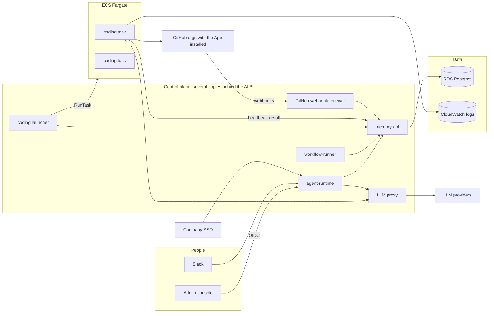

# Multi-User Scale-Out

Status: proposed. Owner: platform. Last updated 2026-10-22.

## Purpose

TS Harness runs today as one EC2 host serving a handful of people. This
document describes how it should change so that about 50 people across one
company can use it at the same time: several teams, several projects per team,
several repositories per project, and repositories spread across more than one
GitHub organization.

It builds on `workflow-engine-production-state.md` and does not change the
governed delivery flow (PRD, work orders, implement, review, QA, release). The
stages, gates and Inbox decisions stay the same. What changes is where the work
runs, who the actor is, and how capacity is shared.

## Goals

- 50 named users, of whom 10–20 are active at once.
- 20–40 OpenCode coding runs at peak, without one person's program starving
  everyone else.
- A deploy, crash or restart of any control-plane service does not lose or
  restart in-flight coding runs.
- Every action has a real person as its actor, programs are private unless
  shared, and approvals are limited to the people given that access.
- Work orders can target any repository the company has installed the GitHub
  App on, in any of its GitHub organizations.
- Spend and rate limits are visible and enforceable per team, project and user.

## Non-goals

- Isolating separate customers from each other. This is one company, so it is
  one tenant. `tenant_id` stays `default`.
- Deploying application code. Release still only records GitHub deployments and
  waits for their status. Infrastructure belongs to each repo's own pipeline.
- Replacing OpenCode or changing review and QA policy.

## Load assumptions

| Unit | Cost | Peak at 50 users |
| --- | --- | --- |
| Chat turn, approval, wait setup | under a second to a minute, small memory | hundreds per hour |
| PRD, planning, review, QA turn | 1–5 minutes, one LLM conversation | 10–30 at once |
| OpenCode coding run | 5–30 minutes, 1–2 GB memory, a full clone on disk | 20–40 at once |

The current host fits about 5–6 coding runs before memory runs out. Everything
except coding fits on a modest control plane. Coding runs are the only part that
needs elastic capacity.

## Where today's design breaks

The small-team changes from October 2026 are in place: the runner hands
dispatches to a thread pool, allows one in-flight task per workflow, keys
workspaces and branches by delivery workflow, and kills OpenCode runs that stop
producing output. The remaining limits are:

1. **Coding runs live inside the runtime container.** `run_coding_backend`
   starts OpenCode with `subprocess.Popen`
   (`runtime/ts_harness/implementation/backends/opencode.py`). Restarting
   `agent-runtime` kills every run in flight.
2. **Dispatch is a blocking HTTP call.** The runner holds a connection and a
   thread for up to `WORKFLOW_RUNNER_DISPATCH_TIMEOUT_SECONDS` (7200s) per
   coding step.
3. **Coordination is in process memory.** The runner's `_state_lock` and
   `_inflight` map, the runtime's per-session `threading.Lock`
   (`gateway/server.py`), and `LeaderElection` all assume one copy of each
   service.
4. **The ready queue is first in, first out.** `list_ready_workflow_tasks`
   orders by `created_at` with no notion of user, team or lane.
5. **Users share a filesystem and credentials.** All clones live under
   `/workspace/dev-agent/coding-backend/` in one container. One personal
   GitHub token opens every PR and makes every API call (about 5,000 calls an
   hour, and it lacked the Deployments and workflow permissions that release
   and CI needed).
6. **Everyone signs in with the shared gateway token.** Every decision is
   recorded with actor `system`, which the chat renders as "An admin".
7. **GitHub is polled.** `poll_github_merges` scans every waiting task every
   minute for merges, PR comments, checks and deployment statuses.
8. **A program has exactly one repository.** `project_identity.py` derives a
   single `project_id`, and release pins one repo.

## Target architecture



The control plane only coordinates. It never runs OpenCode. Coding happens in
short-lived Fargate tasks, one per run. Postgres is the single source of truth
for queues, leases, locks and heartbeats, so any control-plane copy can be
replaced at any time.

## Deployment profiles

Not every install needs the scale-out topology. A team of two or three people
is well served by one EC2 host, as today. One install setting chooses the
topology:

```yaml
deployment_profile: single_host   # or scale_out
```

`single_host` is the default. It keeps today's footprint:

- one EC2 host running one copy of each service
- coding jobs run as local Docker containers on that host, at most 3 at once
- no VPC, ECR, ECS, egress proxy or internal load balancer
- GitHub polling reconciles every 60 seconds

`scale_out` turns on the architecture above:

- a VPC with private subnets, ECR, an ECS cluster and the egress proxy
- coding jobs run as Fargate tasks, up to 20 at once to start
- two runtime and memory API copies, PgBouncer, and batch claims with lanes
- webhook-first GitHub with reconciliation every 15 minutes
- the CloudWatch dashboard

The profile only changes infrastructure and topology. Product features work
the same in both:

- OIDC sign-in, teams, private programs and sharing
- asynchronous coding jobs (on one host they still make runtime restarts safe)
- the GitHub App, multi-repository projects and ordered release tracks
- team budgets and the LLM proxy (one more container on a single host)

Keeping one code path for features avoids maintaining two products, and a
small team benefits from private programs and restart-safe coding runs too.

How it is applied:

- The install contract validates `deployment_profile` and passes it to
  Terraform, which creates the scale-out resources only for `scale_out`.
- Terraform writes the profile into the runtime config:

  ```yaml
  deployment:
    profile: single_host
    overrides: {}            # for example {coding_max_running: 5}
  ```

- Each topology setting (coding launcher, coding concurrency, lane caps,
  GitHub reconciliation interval) resolves in this order: environment
  variable, `deployment.overrides`, then the profile default. A small team can
  raise its coding limit without switching profiles.
- Replica counts and PgBouncer live in a separate compose overlay that the
  bootstrap adds only for `scale_out`.
- `scale_out` is rejected for GCP installs until a Cloud Run Jobs launcher
  exists.

Moving from `single_host` to `scale_out` is a Terraform apply and a restart.
The database stays the same, and coding jobs already queued are picked up by
the new launcher. Moving back reverses the apply after running jobs finish.

## 1. Identity and access

### Sign-in: Auth0 first, any OIDC provider supported

The company signs in through **Auth0**. TS Harness itself stays
provider-neutral: it speaks standard OIDC, and each provider gets a small
preset for the parts OIDC leaves open (where groups come from, which token to
validate). Other installs can use Microsoft Entra ID, Google Workspace, Okta or
any OIDC provider without code changes.

There are two ways to reach a provider:

- **Through Auth0 (recommended for this company).** Auth0 is the only provider
  TS Harness talks to. Teams that use Entra ID, Google Workspace or Okta
  accounts connect to Auth0 as *enterprise connections*, and Auth0 passes their
  identity and groups through in the same token shape. TS Harness sees one
  issuer and one claim format.
- **Directly.** An install without Auth0 points TS Harness at its own provider
  using one of the presets below.

#### Auth0 setup

1. **Application:** type *Single Page Application*, Authorization Code with
   PKCE (no client secret in the browser). Allowed callback and logout URLs are
   the admin console URL. Use a custom domain (for example
   `login.<company>.com`) so the issuer survives an Auth0 tenant move.
2. **API:** create an Auth0 API with identifier `https://ts-harness/api` and
   RS256 signing. The admin console requests this audience, so Auth0 issues a
   JWT access token that the runtime can validate. Without an audience Auth0
   returns an opaque access token that cannot be validated locally.
3. **Groups and roles in the token:** a post-login Action adds two claims to
   the access token, each filtered to names starting with `ts-harness-`:
   - `https://ts-harness/roles`: Auth0 RBAC roles assigned to the user. The
     runtime already reads this claim (`_AUTH0_ROLES_CLAIM` in
     `gateway/identity.py`).
   - `https://ts-harness/groups`: groups from the user's enterprise connection
     (Entra, Google Workspace, Okta) or from Auth0 app metadata. This claim is
     new; the runtime reads it through the new `groups_claim` setting.
4. **Who may sign in:** the same Action denies login unless the user has the
   `ts-harness-users` group or role, and requires a verified email.
5. **Token lifetimes:** access token 1 hour, refresh token rotation on, so a
   blocked user loses access within the hour.

Runtime config:

```yaml
identity:
  provider: oidc
  preset: auth0
  issuer: https://login.<company>.com/
  audience: https://ts-harness/api
  client_id: <auth0 spa client id>
  token_type: access
  groups_claim: https://ts-harness/groups
  roles_claim: https://ts-harness/roles
  allowed_domains: [<company>.com]
  directory: auth0_management
```

Auth0's issuer ends with a slash, and the runtime compares it exactly, so keep
the trailing slash. The authorize and token URLs do not need to be set: the
existing defaults in `admin_bff.auth_config_payload` (`{issuer}/authorize`,
`{issuer}/oauth/token`) are Auth0's paths.

#### Provider presets

`issuer`, `audience`, `jwks_url`, `client_id`, `authorization_endpoint` and
`token_endpoint` already exist in `IdentityConfig`. New settings:

- `preset`: `auth0`, `entra`, `google`, `okta` or `generic`. Sets the defaults
  below.
- Endpoint discovery: endpoints and the JWKS URL are read from
  `{issuer}/.well-known/openid-configuration` when not set, instead of guessing
  paths. This removes the class of bug where Auth0-style defaults are used
  against another provider.
- `token_type`: `access` (validate the access token; preferred) or `id`
  (validate the ID token, audience is the client ID) for providers whose access
  tokens are not meant to be validated by third parties.
- `groups_claim` and `roles_claim`: which claims hold groups and roles.
- `groups_source`: `token`, or a directory lookup when the provider does not
  put groups in tokens.
- `allowed_domains`: email or hosted domains allowed to sign in.
- `directory`: where the Share dialog's people and team list comes from (see
  below).

| Preset | Token validated | Groups come from | Notes |
| --- | --- | --- | --- |
| `auth0` | access token for the TS Harness API | `https://ts-harness/groups` claim set by an Action | Can broker Entra, Google Workspace, Okta and SAML as enterprise connections. |
| `entra` | access token for the app's `api://ts-harness` scope (v2 tokens) | app roles in `roles`; groups as object IDs, or Microsoft Graph lookup | Entra emits group object IDs, not names, and drops the `groups` claim when a user is in more than 200 groups. Use app roles for harness roles, and `groups_source: microsoft_graph` for team membership. |
| `google` | ID token | Google Directory API lookup (`groups_source: google_directory`) | Google tokens carry no groups, and Google access tokens are opaque. Check the `hd` claim against `allowed_domains`. The lookup uses a service account with domain-wide delegation and the `admin.directory.group.readonly` scope, cached for 10 minutes. |
| `okta` | access token from a custom authorization server | `groups` claim filtered to `ts-harness-` | Without custom authorization servers (API Access Management), use `token_type: id`. |
| `generic` | configurable | configurable | Any OIDC provider with discovery. |

#### Directory and offboarding

Sign-in alone only tells TS Harness about people when they sign in. The program
**Share** dialog needs to find people and teams who have not signed in yet, and
access should end promptly when someone leaves. A directory source fills that
gap:

| `directory` | Source | Fits |
| --- | --- | --- |
| `scim` | the provider pushes users and groups over SCIM 2.0 | Entra ID, Okta |
| `auth0_management` | periodic sync from the Auth0 Management API (users, roles, `ts-harness-*` groups in metadata) | Auth0, which does not push SCIM to apps |
| `microsoft_graph` | periodic sync from Microsoft Graph | Entra ID without SCIM |
| `google_directory` | periodic sync from the Google Directory API | Google Workspace |
| `seen_users` | only people who have signed in before | small installs; the fallback |

`identity.scim_enabled` and `/scim/v2/Users` stubs exist but are not
implemented. With any source, a user who disappears or is blocked loses their
grants on the next sync, and their tokens stop working at the next refresh.

#### Day-one Auth0 configuration for this company

- **Connections:** Microsoft Entra ID and Google Workspace as enterprise
  connections, which covers most company accounts. Add Okta or SAML
  connections only when a team needs one. Turn off Auth0's username and
  password database, so everyone signs in with a company account.
- **Groups are managed in Auth0, not taken from the connections.** Each
  `ts-harness-*` group in the table below is an Auth0 RBAC role, assigned to
  people in the Auth0 dashboard. This works the same no matter which
  connection a person signed in with, and gives one place to see who has
  access. The post-login Action copies those role names into both claims.
- **Later, optional:** map groups from a connection automatically (for example
  an Entra group `Payments Engineers` to `ts-harness-team-payments`) in the
  Action, once a team asks for it. The token shape does not change, so
  TS Harness needs no change.

Other sign-in rules:

- The shared gateway token remains for service accounts and emergency access
  only. It is never shown to people and is not used for day-to-day sign-in.
- Slack users are linked to their identity by verified email the first time
  they message the bot. Until linked, Slack can read status but cannot approve
  or start programs.

### Identity groups

Group names are the same whatever the provider. With Auth0 they can be Auth0
roles, metadata groups or groups passed through from an enterprise connection.

| Group | Meaning |
| --- | --- |
| `ts-harness-users` | may sign in; company-wide viewer of public programs |
| `ts-harness-admins` | harness admin: config, models, allowlists, all programs including private ones |
| `ts-harness-team-<slug>` | member of team `<slug>`, for example `ts-harness-team-payments` |
| `ts-harness-team-<slug>-approvers` | may approve gates on programs shared with that team |
| `ts-harness-team-<slug>-managers` | may raise that team's LLM budget |

Teams are created in TS Harness from the `ts-harness-team-*` groups, so team
membership is managed in the identity provider, not in harness config. On
Entra, where groups arrive as object IDs, the team sync maps each ID to its
display name through Microsoft Graph.

### Teams, projects and roles

Add two scopes above programs:

- **Team**: a group of people, for example Payments or Mobile, backed by an
  identity-provider group.
- **Project**: owned by one team; has repositories, a Jira project, release
  environments and default approvers.

Roles keep the existing bundles in `policy/permissions.py` (viewer, requester,
approver, admin, owner):

```yaml
identity:
  group_roles:
    ts-harness-users: [requester]
    ts-harness-admins: [admin]
  team_groups:
    prefix: ts-harness-team-
    approver_suffix: -approvers
    manager_suffix: -managers
```

`group_roles` already exists and grants company-wide roles. `team_groups` is
new and turns identity-provider groups into teams, team approvers and team
managers. Company-wide roles say
what a person may do in general (for example, start a program). Whether they
may do it **to a given program** is decided by program access, below.

### Program access: private by default

Programs work like private GitHub repositories.

- A new program is **private**. Only its creator can see it, plus harness
  admins (for support and audit).
- The creator (as program owner) can **share** it with teams or individual
  people, each with an access level.
- An owner can make the program **public**. Every signed-in person in the
  company can then see it. Actions still need an access grant.

Access levels:

| Level | Can |
| --- | --- |
| `read` | see the program, its artifacts, PRs and activity |
| `write` | also chat in the program thread, start revisions, retry, upload artifacts |
| `approve` | also approve or reject gates and make stuck-step decisions |
| `admin` | also share, change visibility, cancel, transfer ownership |

The creator gets `admin`. Sharing with a team gives its members the chosen
level. Members of `ts-harness-team-<slug>-approvers` also get `approve` on
programs shared with that team at `write` or higher. A person's access is the
highest of their direct grant, their team grants, and public read.

Data model:

- `delivery_programs.visibility` (`private` or `public`, default `private`)
  and `delivery_programs.owner_id` (the creator's identity subject).
- `program_access (program_id, principal_type, principal_id, level, granted_by, granted_at)`
  where `principal_type` is `user` or `team`.

Enforcement:

- Every program read goes through one access check in the memory API: program
  lists, status, phase activity, artifacts, evidence export, the Inbox, chat
  threads and notifications. A private program the actor cannot read returns
  404, not 403, so its existence is not revealed.
- Actions check the level: `/admin/workflows/approve`, `/reject` and `/decide`
  need `approve`; chat `/revise`, `/accept` and `/stop` need `approve`; Advance,
  Cancel and sharing need `admin`.
- Workflows, tasks, coding jobs and artifacts inherit their program's access.
  There is no separate permission on them.
- The Inbox only lists gates on programs where the actor has `approve`.
- Slack and chat notifications go only to people who can read the program.
- Visibility changes and grants are audited.
- Harness admins can read and act on every program, including private ones.
  When an admin opens a private program they have no grant on, the access is
  recorded in the audit log with the admin's identity, so support access is
  visible to the program owner.

Repository access stays separate. Sharing a program does not give anyone
access to its GitHub repositories, and the harness never exposes repository
content beyond what the program already shows (diffs, PR links, review
findings).

### Audit

Every audit row and workflow decision records the SSO subject and email. The
"An admin" fallback in `human_decisions.display_actor` then only appears for
service-account actions.

## 2. Projects with several repositories

### Data model

New tables, all keyed by `tenant_id` as today:

- `teams (id, slug, name)`
- `projects (id, team_id, key, name, jira_project_key, default_base_branch)`
- `project_repositories (project_id, github_host, owner, repo, installation_id, default_branch, role)`
  where `role` is a free label such as `web`, `api` or `infra`.
- `delivery_programs.project_id` becomes a foreign key to `projects` instead of
  a string inferred by `project_identity.py`.

### Work orders

- Each work order targets exactly one repository (`repo: owner/name`). The
  planner stage must split work that spans repositories into one work order per
  repository, with `depends_on` between them, for example an API work order
  before the web work order that calls it.
- Coding jobs, branches and PRs are keyed by delivery workflow and repository.
  `work_order_branch_name` already appends the delivery workflow suffix.
- Waves continue to run independent work orders in parallel, now possibly
  across repositories.

### Release

Decision: **separate release tracks per repository, in dependency order.**

Today a program changes one repository, so release has one CI wait, one
staging approval and one production approval. When a program changes several
repositories, each changed repository gets its own track with the same steps
it has today: plan, CI wait on the merge SHA, staging approval, staging
deployment, staging record, production approval, production deployment,
production record.

Tracks are ordered by the dependencies between work orders. If a
`payments-web` work order depends on a `payments-api` work order, the web
track depends on the API track:

- the web staging approval does not open until the API staging deployment is
  recorded as succeeded,
- the web production approval does not open until the API production
  deployment is recorded as succeeded.

Repositories with no dependency between them move independently. Example with
three repositories, where web depends on api and docs depends on nothing:

| Track | Staging gate opens when | Production gate opens when |
| --- | --- | --- |
| `payments-api` | its CI passes | its staging is recorded |
| `payments-web` | its CI passes and api staging is recorded | its staging is recorded and api production is recorded |
| `payments-docs` | its CI passes | its staging is recorded |

How it is built:

- `plan_release` emits one track per changed repository and turns work-order
  dependencies into repository dependencies. The repository graph is
  deduplicated (several work orders in the same pair of repositories give one
  edge).
- Each track's approval tasks get `depends_on` entries on the upstream track's
  record tasks. The runner, the memory API's dependency check and the program
  page's "only the ready gate shows Approve" rule already behave correctly with
  that graph.
- A failed or rejected upstream track blocks only its dependents. Independent
  tracks continue. The program's release phase succeeds when every track has
  recorded production.
- Work orders that depend on each other in both directions across two
  repositories (api needs web and web needs api) would make a cycle. The
  planner rejects that plan and asks for the work to be split differently,
  because those changes cannot be released safely in any order.
- The program page groups release activity by repository, with the dependency
  shown on each track ("waits for payments-api production").

## 3. GitHub App across several organizations

Replace the personal access token with a GitHub App owned by the company.

- Install the App in each GitHub organization, choosing the repositories it may
  access. Org admins control access in GitHub, not in harness config.
- Permissions: Contents read/write, Pull requests read/write, Checks read,
  Commit statuses read/write, Deployments read/write, Actions read, Issues
  read/write, Workflows read/write only if the harness must edit
  `.github/workflows`.
- The control plane holds the App private key in AWS Secrets Manager. For each
  call it mints an installation token for the repository's owner, scoped to the
  single repository (`repository_ids`). Tokens are cached until a few minutes
  before their one-hour expiry.
- Each installation has its own rate limit, so load spreads across
  organizations.
- PRs and commits are authored by the App's bot account. Commits carry
  `Co-authored-by:` for the person who started the program, and the PR body
  names them.

All organizations are on github.com today. GitHub Enterprise Server may come
later, so the design keeps the host explicit instead of assuming github.com:

- `project_repositories.github_host` defaults to `github.com`.
- The GitHub client takes its API base URL from the host (`https://api.github.com`
  for github.com, `https://<host>/api/v3` for Enterprise Server).
- App registrations are stored per host. An Enterprise Server instance needs
  its own App registration, private key and webhook secret, because Apps do not
  span hosts.
- Supporting a new Enterprise Server host is then configuration, not code.

### Webhooks instead of polling

All installations deliver to one endpoint, `POST /webhooks/github`, on the
control plane.

- Verify the `X-Hub-Signature-256` signature and record the delivery ID to drop
  duplicates.
- Map events to the existing external waits: `pull_request` closed and merged
  to `github.merge`, `check_run`, `check_suite` and `status` to
  `github.pr_checks`, `deployment_status` to `github.deployment_status`, and
  `issue_comment` or `pull_request_review` to the revise commands.
- `poll_github_merges` stays as a slow reconciliation sweep (every 15 minutes)
  for missed deliveries, instead of the primary mechanism.

## 4. Coding runs as asynchronous jobs on ECS Fargate

### Flow

1. The runner claims a `run_coding_backend` task. Instead of calling the
   runtime and waiting, it inserts a row into `coding_jobs` and marks the task
   blocked with `awaiting_external:coding.finished`. This reuses the same
   external-wait mechanism as merges, checks and deployments
   (`hooks/wait_external.py`, `memory.resume_external`).
2. The **coding launcher** (a small control-plane loop, one active copy at a
   time) claims queued jobs within capacity, mints a repository-scoped GitHub
   token and calls ECS `RunTask` with the job ID.
3. The Fargate task fetches its job spec from the memory API, clones the
   repository onto its own ephemeral disk, runs OpenCode and verification, and
   pushes the branch and PR.
4. While running, it sends a heartbeat every 30 seconds with its last output
   line, and asks for a fresh GitHub token if the current one is within ten
   minutes of expiry.
5. On exit it writes the result (verification output, PR URL, changed files,
   revision scope) to `coding_jobs`. The memory API resumes the waiting task with
   that result. Review, QA, revision limits and Inbox decisions see the same
   output shape they see today.

### `coding_jobs`

| Column | Purpose |
| --- | --- |
| `id`, `tenant_id` | identity |
| `workflow_id`, `task_id` | the waiting delivery task |
| `team_id`, `project_id`, `requested_by` | fairness and quotas |
| `repo`, `base_branch`, `work_branch` | target |
| `spec` | prompt, mode, revision files, verification commands |
| `status` | `queued`, `launching`, `running`, `succeeded`, `failed`, `cancelled`, `lost` |
| `ecs_task_arn`, `attempt` | launcher bookkeeping |
| `heartbeat_at`, `last_output` | liveness for the watchdog and the program page |
| `result`, `error` | outcome handed back to the task |
| `created_at`, `started_at`, `finished_at` | wait and run time metrics |

### Watchdog and cancellation

- A sweep marks a running job `lost` when `heartbeat_at` is older than five
  minutes, stops its ECS task, and resumes the delivery task with a failure the
  revision policy already understands.
- A hard limit per job (default 60 minutes) stops runaway runs.
- The OpenCode no-output stall detector stays inside the worker as a faster,
  finer check.
- Cancelling a program or work order cancels queued jobs and stops running ECS
  tasks.

### Worker task definition

- Image: the existing agent runtime image's coding layer (OpenCode, git, Node,
  Python, the test-runner requirements in `docker/test-runner-requirements.txt`)
  with a small worker entrypoint. No gateway, no chat.
- Size: 2 vCPU and 4 GB memory by default, with a per-project override for large
  repositories. Ephemeral storage 50 GB.
- Networking: private subnets with outbound access through a NAT gateway.
  Security groups cannot filter by domain, so outbound traffic goes through an
  egress proxy (or AWS Network Firewall) that allows the GitHub hosts, package
  registries and the LLM proxy only.
- Credentials: the task role can read only its own job and write its own
  heartbeat and result through the memory API, using a per-job token issued by
  the launcher. It never sees the GitHub App private key or raw LLM provider
  keys.
- Logs: full output to CloudWatch Logs under the job ID. The program page links
  to it and shows `last_output` live.
- Private package registries (optional, per project): see below.

### Private package registries

None are needed today. They are added per project in the admin console when a
project first needs one, with no config file or deploy.

**Who:** harness admins, and managers of the team that owns the project.

**Project settings → Package registries → Add registry:**

| Field | Example |
| --- | --- |
| Type | npm, PyPI, Maven, NuGet, Go proxy, container registry |
| URL | `https://npm.pkg.github.com`, `https://<company>.jfrog.io/artifactory/api/pypi/pypi/simple` |
| Scope (npm only) | `@company` |
| Credential | token, or username and password |

- The credential is write-only. It is stored in AWS Secrets Manager under the
  project and is never shown again in the console or API. It can be replaced
  or deleted.
- **Test connection** makes one authenticated request from the control plane
  through the egress proxy and reports success or the HTTP error.
- Saving a registry adds its host to that project's egress allowlist.
- When a coding job starts, the launcher passes the project's registry list,
  and the worker writes the package-manager config (`.npmrc`, `pip.conf`,
  `settings.xml`, Docker credentials) inside its own disk. Only jobs for that
  project receive the credentials, and they are never written into the
  repository, the PR or logs.
- Adding, replacing, testing and deleting a registry are audited.

Data model: `project_registries (id, project_id, type, url, scope, secret_arn, created_by, created_at, last_tested_at, last_test_ok)`.

### Capacity

- Check the account's Fargate On-Demand vCPU quota before launch. 40 runs at 2
  vCPU need 80 vCPU.
- The launcher's global cap (`CODING_MAX_RUNNING`) starts at 20 and is raised
  once cost and provider limits are understood.
- Cold start is 30–90 seconds, which is small next to a 5–30 minute run.

## 5. Scheduling and fairness

### Lanes

| Lane | Work | Cap |
| --- | --- | --- |
| fast | approvals, barriers, wait setup, short hooks | high, per runner thread pool |
| agent | PRD, planning, review, QA turns in agent-runtime | sized to runtime copies and LLM limits |
| coding | `coding_jobs` | launcher cap and quotas below |

Each workflow step declares its lane in the workflow definition. The default is
`agent`, and `run_coding_backend` steps are `coding`.

### Quotas

Defaults, configurable per team and project:

- at most 2 running coding jobs per user,
- at most 3 per program (one wave),
- at most 8 per team,
- the global cap above.

### Fair ordering

Within a lane, queued work is ordered by how much its requester and team already
have running, then by age. A program with ten work orders gets its share, but
cannot fill every slot while others wait. Approved human gates and resumes of
waiting tasks jump the queue, because a person is usually watching.

## 6. Making the control plane safe to replicate

### Runner

Claim in one statement instead of listing then claiming per task:

```sql
UPDATE workflow_tasks t
SET status = 'running', locked_by = %(runner)s,
    lock_expires_at = now() + make_interval(secs => %(lease)s),
    attempt = attempt + 1
WHERE t.id IN (
  SELECT c.id FROM workflow_tasks c
  WHERE c.status = 'pending'
    AND c.lane = %(lane)s
    AND c.attempt <= c.max_retries
    AND (c.next_attempt_at IS NULL OR c.next_attempt_at <= now())
    AND (c.approval_required = false OR c.approval_status = 'approved')
    AND NOT EXISTS (SELECT 1 FROM workflow_tasks d
                    WHERE d.id = ANY(c.depends_on) AND d.status <> 'succeeded')
    AND NOT EXISTS (SELECT 1 FROM workflow_tasks r
                    WHERE r.workflow_id = c.workflow_id AND r.status = 'running')
  ORDER BY c.created_at
  LIMIT %(n)s
  FOR UPDATE SKIP LOCKED
)
RETURNING t.*;
```

- The in-process "one in-flight task per workflow" rule becomes the last
  `NOT EXISTS`.
- The in-process `_state_lock` becomes `pg_advisory_xact_lock` on the workflow
  ID around each transition and its hooks, so two runners never advance the
  same workflow at once.
- Running tasks renew their lease while they run.
- `LeaderElection` only guards the singleton sweeps (stale leases, wait
  deadlines, GitHub reconciliation, the coding launcher).

### Agent runtime

- Several copies behind the existing ALB module.
- The per-session lock becomes a Postgres advisory lock keyed by session ID,
  taken for the duration of a turn. Sessions are already stored in Postgres.
- Rolling deploys with connection draining. Because coding runs no longer live
  in the runtime, a deploy only interrupts in-progress chat or agent turns, and
  those are retried by the runner as today.

### Memory API

- Several copies behind an internal load balancer. It holds no in-process state
  beyond caches.
- Add RDS Proxy or PgBouncer in transaction mode once there are more than a
  few copies of each service.
- Remove its remaining optional import of `ts_harness`
  (`build_operability_status` in `get_delivery_program_status`). Today the
  memory image cannot import the runtime package, so that field is silently
  empty and Inbox misses workflow gates. Move that computation to the runtime
  or vendor it into the memory API.

## 7. LLM proxy, metering and cost

- All LLM calls, from agent-runtime and from coding workers, go through one
  internal proxy that speaks the provider APIs.
- The proxy attaches the team, project, program, workflow and user to each call
  and records tokens and cost in Postgres.
- It enforces provider rate limits with a shared token bucket per provider and
  model.
- Workers receive a short-lived proxy token instead of provider keys.

### Team budgets

Each team has a monthly LLM budget. Defaults come from config, and managers
raise them in the admin console.

```yaml
budgets:
  currency: USD
  default_team_monthly: 5000
  warn_at_percent: 80
  manager_max_monthly: 10000
  teams: {}
```

Every team starts at 5,000 USD a month. Managers can raise their team's budget
up to 10,000 USD a month on their own; anything higher needs a harness admin.

- `default_team_monthly` applies to every team without its own entry. `teams`
  overrides it per team.
- Members of `ts-harness-team-<slug>-managers` can raise their own team's
  budget in the admin console, up to `manager_max_monthly`. Harness admins can
  set any amount.
- A raise can be for the current month only or permanent. It is stored in
  Postgres, overrides the config value, and is audited with who raised it, by
  how much, and why.
- At `warn_at_percent` the team's managers and the owners of its running
  programs are notified. At 100% new agent turns and coding jobs for that team
  wait in the queue with the reason "team budget reached", and the program page
  offers managers a **Raise budget** action. Work already running finishes.
- Spend is attributed to the team that owns the program's project, not to the
  people the program is shared with.

## 8. Observability

Dashboards and alerts, from runner, launcher and proxy metrics:

- queue depth and oldest-waiting age per lane,
- running coding jobs per team and against the cap,
- coding job duration, outcome and lost or stalled counts,
- time waiting for a human per gate,
- GitHub rate-limit remaining per installation,
- LLM tokens, cost and throttling per team.

Alert when the oldest queued coding job waits more than 15 minutes, when lost
jobs exceed a threshold, or when an installation drops below 10% of its rate
limit.

## Migration plan

Each phase ships on its own and keeps the delivery flow working.

**Phase 0: deployment profiles.** Add `deployment_profile` to the install
contract and Terraform, the `deployment:` runtime config section, and the
setting resolver, so every later phase reads its topology settings from the
profile. Existing installs default to `single_host` and do not change.

**Phase 1: identity and program access.** Add provider presets, OIDC
discovery and the `groups_claim` setting. Configure the Auth0 application, API
and post-login Action, enable OIDC in the admin console, link Slack
identities, create teams from `ts-harness-team-*` groups, and add
private-by-default programs with sharing. Keep the gateway token for services.
This removes "An admin" attribution and is independent of the rest. Existing
programs are migrated as `public` so nothing disappears for current users.
Phase 1b adds the directory sync (`auth0_management` first, then `scim`,
`microsoft_graph` and `google_directory`) for the Share dialog and offboarding.

**Phase 2: async coding jobs on the current host.** Add `coding_jobs`, the
`coding.finished` wait and the launcher, with a local launcher that runs the
worker as a Docker container on the same EC2 host. This proves the job contract,
heartbeats and watchdog while capacity is still one box, and makes runtime
restarts safe for coding runs.

**Phase 3: Fargate workers.** Swap the local launcher for ECS `RunTask`, add the
task definition, egress proxy and per-job credentials in Terraform under
`infra/aws`. Raise the coding cap.

**Phase 4: GitHub App and webhooks.** Register the App, install it in each
organization, add `project_repositories`, mint scoped tokens, and receive
webhooks. Reduce polling to reconciliation. Retire the personal token.

**Phase 5: multiple repositories per project.** Planner splits work orders by
repository; release runs one track per repository in dependency order.

**Phase 6: replicate the control plane.** Single-statement claims with lanes and
fair ordering, advisory locks for workflows and sessions, several runtime,
runner and memory-API copies, connection pooling.

**Phase 7: LLM proxy and team budgets, then dashboards and alerts.**

The **Package registries** settings page ships with phase 3, because Fargate
workers are what consume it. Projects then add registries in the admin console
whenever they need one.

Phase 0 comes first because it is small and every later phase depends on it.
Phases 2–3 give the largest capacity and reliability gain and should start
first after phase 1. Phases 4 and 5 can run in parallel with them. Phase 3 is
only deployed on `scale_out` installs.

## Decisions

| Question | Decision |
| --- | --- |
| GitHub Enterprise Server | Not today. Keep the host explicit so it can be added by configuration. |
| Program visibility | Private by default. Owners share with teams or people, or make the program public company-wide. |
| Identity provider | Auth0 for this company, brokering Entra ID, Google Workspace and Okta as enterprise connections. TS Harness stays provider-neutral with presets for Auth0, Entra ID, Google Workspace, Okta and generic OIDC. |
| Releases across several repositories | One track per repository, ordered by work-order dependencies. |
| Auth0 day-one setup | Entra ID and Google Workspace enterprise connections; `ts-harness-*` groups managed as Auth0 roles; connection group mapping later. |
| LLM budgets | 5,000 USD per team per month by default; team managers raise it in the admin console up to 10,000 USD; admins set any amount. |
| Private package registries | None today. Added per project in the admin console by admins or the owning team's managers; credentials in Secrets Manager. |
| Admin access to private programs | Yes, for support and audit. Admin access without a grant is recorded in the audit log. |
| Small installs | `deployment_profile: single_host` (default) keeps one EC2 host; `scale_out` enables the distributed topology. Features are the same in both. |

## Open questions

None at this time.
