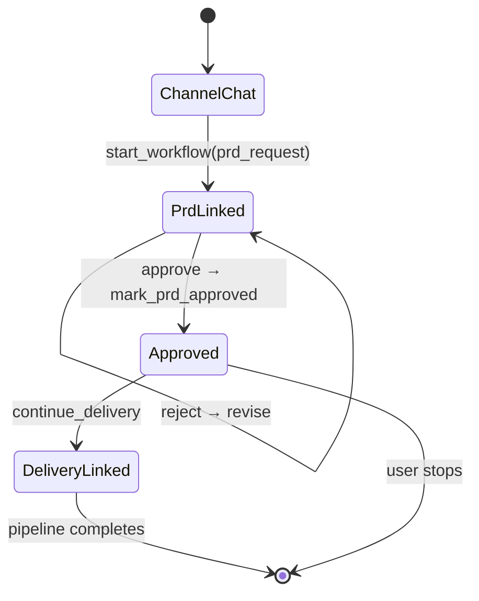

# PRD-First Governed Delivery Flow

## Overview

Governed product delivery uses a **delivery program** coordinator linking phase workflows:

1. **`prd_request` (v1.2)** — intake → draft PRD → approve PRD (with revise loop). Program phase: `prd`.
2. **`jira_from_prd` (v1.0)** — create Jira from approved PRD. Program phase: `jira`.
3. **`work_orders_from_prd` (v1.0)** — Refinery/Foundry/Planner + prepare handoff. Program phase: `work_orders`.
4. **`implement_delivery` (v1.0)** — implement Jira tickets → await merge. Program phase: `implement` (Jira track).
5. **`implement_work_orders` (v2.0)** — fork a wave of ready work orders as `deliver_work_order` child workflows, join them, and re-enter with the next wave until every WO is done. Program phase: `implement` (work-orders track).
6. **`deploy_release` (v3.0)** — one `release_track` per repository, ordered by work-order dependencies. Each track runs CI on its merge SHA, then promotes to staging and production through the repo's GitHub deploy, each behind a recorded promote decision. Program phase: `release` (terminal, automatic after `implement`).
7. **`rollback_release` (v1.0)** — redeploy the last successful SHA for one environment. Program phase: `rollback` (startable on demand).

In-flight `implement_work_orders` 1.x workflows stay on their pinned version and keep delivering one work order at a time.

The legacy **`governed_delivery`** skeleton remains loader-only for in-flight historical records; new work uses the phase skeletons above.

## One program per change

Every change has one **root** delivery program. Work started for that change from another flow becomes a **child** program linked by `parent_program_id` (the gateway also stores `root_program_id`):

- `content_to_jira_work_orders`, `bug_to_jira_work_orders`, and `jira_to_pr` run as child programs of the change they serve. Shared state is the Jira pointer block plus Drive, not a shared TS Harness session. See [`content-to-jira-work-orders.md`](../runbooks/content-to-jira-work-orders.md), [`bug-to-jira-work-orders.md`](../runbooks/bug-to-jira-work-orders.md), and [`jira-to-pr.md`](../runbooks/jira-to-pr.md).
- `program_status` on the root rolls up child status. The `release` node sets `await_children: true`, so the root's automatic advance waits until every child program finishes.
- Every Jira issue, PR, branch and deployment a program creates is recorded in `program_external_refs`. Cancelling the root cancels active children and runs cancel compensation over the refs of the whole tree.
- Human decisions (gates, track choice, promotions, governance changes) are recorded in `workflow_decisions` with the actor and their roles.

The portfolio board (Admin Console **Programs**) lists root programs only. It shows phase, status, owner, child count, what the program is waiting on and for how long, whether the wait was escalated, and the recommended action.

## User journeys

### Governed PRD

1. User: "Create a PRD from these requirements"
2. Orchestrator: `propose_start_workflow(prd_request)` → user confirms → `start_workflow`
3. Workflow runs intake, draft, approval gate
4. On reject: `revise_on_reject` loop back to approval
5. On approve: `mark_artifact_approved` — session `workflow_phase=approved`, no downstream tasks materialized

### Delivery opt-in (fork after PRD)

1. Orchestrator asks: Jira tickets or work orders?
2. User chooses → `propose_bridge_workflow` (or legacy `propose_continue_delivery`) → confirm → `bridge_workflow`
3. Program advances to `jira` or `work_orders` with `planning_track` artifact set
4. Session `mode=bridge_linked`, tasks materialized from phase intake with seeded artifact input

### Informal PRD

User says "quick draft, no approval" → `propose_delegate_task(pm-agent)` (no durable workflow).

## Session metadata

| Key | Values |
|-----|--------|
| `mode` | `channel_chat`, `workflow_linked`, `bridge_linked` |
| `workflow_type` | `prd_request`, `jira_from_prd`, `work_orders_from_prd`, `implement_delivery`, `implement_work_orders`, `deploy_release`, `rollback_release` |
| `workflow_phase` | `drafting`, `awaiting_approval`, `approved` |
| `approved_artifact` | dict from gate output |
| `source_workflow_id` | source workflow for bridge handoff |
| `pending_bridge` | `{source_workflow_id, summary, target_workflow_type?}` |
| `last_intent` | classifier audit (`governed_prd`, etc.) |

Legacy keys (`prd_phase`, `prd_linked`, `approved_prd_artifact`, `pending_continue_delivery`) are read for backward compatibility but no longer written.

## Intent routing

Deterministic classifier in `runtime/ts_harness/routing/intents.py` runs on channel ingress. When `TS_HARNESS_INTENT_ROUTING=true` (default), routing policy from `routing.intents` in runtime yaml denies unsafe tool paths (e.g. delegate when a governed workflow is required).

## State machine

